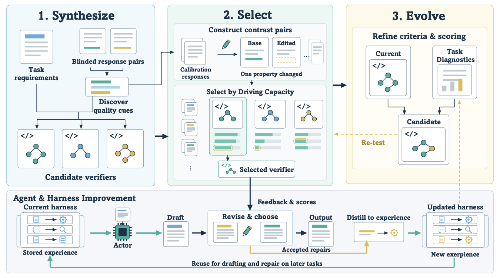

<div align="center">

  <h3>Verifier&ndash;Harness Co-Evolution for Training-Free Self-Improvement on Open-Ended Tasks</h3>

  <p><b>UCoE (Unified Co-Evolution)</b> &nbsp;&middot;&nbsp; ICLR 2027 (under review)</p>

  <p>
    <a href="https://tianyi0216.github.io/">Tianyi Xu</a><sup>1,*</sup>&nbsp;&middot;&nbsp;
    <a href="https://mercury7353.github.io/Yaolun-Zhang.github.io/">Yaolun Zhang</a><sup>1,4,*</sup>&nbsp;&middot;&nbsp;
    Yiran Wu<sup>2,*</sup>&nbsp;&middot;&nbsp;
    Joe Nguyen<sup>1</sup>&nbsp;&middot;&nbsp;
    Shengyu Dai<sup>3</sup>&nbsp;&middot;&nbsp;
    Saba Moeinizade<sup>3</sup>&nbsp;&middot;&nbsp;
    Zhenwen Shao<sup>3</sup>&nbsp;&middot;&nbsp;
    Qingyun Wu<sup>2,4</sup>&nbsp;&middot;&nbsp;
    <a href="https://huazhengwang.github.io/">Huazheng Wang</a><sup>1&#9993;</sup>
  </p>

  <p>
    <sup>1</sup> Oregon State University &nbsp;&nbsp;
    <sup>2</sup> Pennsylvania State University &nbsp;&nbsp;
    <sup>3</sup> Johnson &amp; Johnson &nbsp;&nbsp;
    <sup>4</sup> AG2 AI
  </p>

  <p>
    <sup>*</sup> Equal contribution &nbsp;&nbsp;
    <sup>&#9993;</sup> Corresponding author
  </p>

  <p>
    
    <!-- arXiv badge: uncomment once the preprint is posted.
    <a href="https://arxiv.org/abs/XXXX.XXXXX">
      
    </a>
    -->
    <a href="https://github.com/tianyi0216/Unified-Co-Evolution">
      
    </a>
    
    
  </p>

</div>

---

## Overview

<p align="center">
  
</p>

UCoE is a training-free self-improvement method for open-ended tasks. It evolves an **executable verifier program** together with the **harness state** that shapes how a fixed actor handles later tasks, while every model parameter stays frozen. The verifier model synthesizes candidate verifier programs (criterion scorers plus an aggregation expression) and tests them on **response contrasts**: pairs of responses that differ in exactly one declared property with a known preferred side. UCoE deploys the candidate whose discrimination on its *weakest* contrast family is highest, a quantity the paper calls **driving capacity**. On every task the deployed verifier diagnoses one weakness in the draft, guides a single local repair, decides whether the draft or the revision is served, and gates whether the accepted repair may enter the harness state as a generalized procedure. At scheduled checkpoints, diagnostics from completed tasks seed new candidate verifiers, which must beat the current verifier on the same contrasts before adoption.

Across six open-ended benchmarks UCoE averages **59.00%** tie-adjusted preference against matched direct generation with Qwen3-8B and **57.19%** with Qwen3.8-27B (50 is parity). On three verifiable benchmarks it raises the mean from **36.06%** (direct generation) to **38.48%**. Inside the Codex coding-agent harness on SpreadsheetBench-2 it reaches **22.7%** exact-match accuracy against **17.3%** for both direct generation and a fixed LLM judge.

This repository contains the UCoE pipeline (`src/`), the benchmark adapters and data preparation scripts (`data/`), the evaluation protocol (`src/eval/`), and the agent-harness port used for the SpreadsheetBench-2 study (`src/agent_harness/`).

## Setup

```bash
conda create -n ucoe python=3.11 -y
conda activate ucoe
pip install -r requirements.txt
```

The pipeline itself runs on Python 3.9 or newer with PyYAML as its only hard dependency; `requirements.txt` adds the optional packages with Python-version markers, so the Tinker backend (`tinker`, Python 3.11+) and the Hard-MATH answer matcher (`math-verify`, Python 3.10+) are installed only where their floor is met and silently skipped elsewhere.

Model access is selected by `models.backend` in the config:

```bash
# Tinker backend (paper main experiments; Qwen3-8B / Qwen3.8-27B / Qwen3.6-35B-A3B / Qwen3.5-397B-A17B);
# needs Python 3.11+ and `pip install tinker`
export TINKER_API_KEY=...

# Any OpenAI-compatible chat-completions server (vLLM, OpenAI, Azure): set models.backend: openai
export OPENAI_API_KEY=...            # or the variable named by models.openai.api_key_env
# and point models.openai.base_url at the server in the config
```

The agent-harness study additionally needs **LibreOffice** (`soffice` on `PATH`, or `SOFFICE=/path/to/soffice`) for workbook recalculation, `openpyxl`, and the **Codex CLI** app server with access to the GPT-5.6 models named in `configs/ssb2_codex.yaml`.

## Quick start

```bash
# 1. Build the frozen task stream, calibration pool and evaluation sidecar for the configured benchmark.
bash process_data.sh

# 2. Run the UCoE lifecycle: direct-generation drafts -> relation discovery -> contrast banks -> deployment stream.
bash run_ucoe.sh

# 3. Evaluate: tie-adjusted preference against direct generation, plus the benchmark's native metric.
bash eval.sh

# 4. (Optional) The SpreadsheetBench-2 study inside the Codex agent harness
#    (manifest -> pin-probe -> smoke -> run for the native, judge and ucoe arms -> official -> report).
bash run_agent_harness.sh configs/ssb2_codex.yaml all
```

Each launcher accepts an optional config path, and `run_ucoe.sh` / `eval.sh` an optional stage or mode:

```bash
bash process_data.sh configs/wildbench_qwen27b.yaml
bash run_ucoe.sh configs/wildbench_qwen27b.yaml            # stage defaults to "all"
bash run_ucoe.sh configs/wildbench_qwen27b.yaml banks      # all | raw | discover | banks | run | status
bash eval.sh configs/wildbench_qwen27b.yaml native         # preference | native | all
```

The launchers wrap the module CLIs, which can also be called directly from the repo root:

```bash
python -m src.run --config config.yaml --stage all [--n N] [--workers W]
python -m src.eval.run --config config.yaml --mode preference [--arms ucoe,raw]
python -m src.agent_harness.run --config configs/ssb2_codex.yaml <manifest|pin-probe|smoke|calib-drafts|banks|h0|run --arm A|status|official|report|audit>
```

`configs/smoke_mock.yaml` runs the whole lifecycle offline on a deterministic mock backend (six Arena-Hard tasks, one checkpoint, no API keys, any Python 3.9+) and is the fastest way to check an installation; `configs/smoke_mock_rd.yaml` does the same with relation discovery enabled:

```bash
bash process_data.sh configs/smoke_mock.yaml                      # Arena-Hard stream from the frozen bundle
bash run_ucoe.sh configs/smoke_mock.yaml && bash eval.sh configs/smoke_mock.yaml preference
python -m unittest discover -s tests -v                           # verifier, selection, memory, contrasts, agent core, mock smoke
```

## Repository layout

```
Unified-Co-Evolution/
├── config.yaml                 default run: Arena-Hard, Qwen3-8B actor, Qwen3.6-35B-A3B verifier model, Tinker backend
├── configs/                    one preset per paper setting (see "Reproducing paper results")
├── process_data.sh             bash process_data.sh [config.yaml]
├── run_ucoe.sh                 bash run_ucoe.sh [config.yaml] [stage]
├── eval.sh                     bash eval.sh [config.yaml] [preference|native|all]
├── run_agent_harness.sh        bash run_agent_harness.sh [configs/ssb2_codex.yaml] <cmd>
├── data/                       prepare_<benchmark>.py scripts, frozen prompt bundles (data/frozen/), processed streams (data/processed/)
├── src/
│   ├── run.py                  stage driver (raw -> discover -> banks -> run)
│   ├── ucoe/                   verifier programs, synthesis, contrasts, relation discovery, selection, revision, memory, lifecycle
│   ├── benchmarks/             one adapter per benchmark (prompts, criteria, contrast families, splits)
│   ├── llm/                    Tinker / OpenAI-compatible / mock transports, cached client, call metering
│   ├── eval/                   preference protocol and native metrics
│   └── agent_harness/          UCoE inside the Codex harness for SpreadsheetBench-2
└── tests/
```

Every stage is resumable: rows are appended atomically, state is written with atomic replace, and every LLM call is cached in a JSONL ledger keyed by request hash, so re-running a finished stage costs nothing. A run leaves `raw/` (direct-generation drafts), `relations/` (discovered relation modules), `banks/` (contrast banks per checkpoint and split), `ucoe/` (per-task rows, harness state, checkpoint reports) and `eval/` under `output.work_dir`.

## Configuration

All runtime behavior is driven by a single YAML file (`config.yaml` by default, which reproduces the Arena-Hard / Qwen3-8B cell). Values may reference other keys with `${a.b.c}`. Top-level groups:

| Key | Purpose |
|-----|---------|
| `benchmark.{name,data_dir,n_tasks,seed}` | Which benchmark adapter to run and where its processed stream lives |
| `models.{backend,actor,verifier,comparator,judge}` | `tinker`, `openai` or `mock` transport; the fixed actor, the verifier model, the larger comparison model for relation discovery, and the final judge. `models.openai.{base_url,api_key_env,extra_body}` configures an OpenAI-compatible server |
| `decoding.{generation,revision,scoring,synthesis,localize,distill,judge}` | Per-role `max_tokens` / `temperature` (and `thinking` for synthesis); adapters supply the paper defaults, config overrides them |
| `ucoe.{initial_candidates,candidates_per_checkpoint,max_new_criteria,eps,checkpoints,regression_tolerance,update_rule}` | Lifecycle hyperparameters: candidate budgets, acceptance margin, checkpoint schedule, regression tolerance, and the update rule (`relative` = paper; `hard` = conservative confidence-bound ablation) |
| `ucoe.contrasts.{selection_per_family,heldout_per_family,relation_selection_per_family,relation_heldout_per_family}` | Contrast quotas per family and split |
| `ucoe.relation_discovery.{enabled,n_discovery_prompts,max_pairs,max_modules,min_recurrence}` | Relation discovery on development prompts (benchmark-specific contrast families) |
| `ucoe.memory.{capacity,per_dimension,max_retrieved,token_cap,dedup_jaccard,at_draft}` | Bounded procedural memory (the harness state of the main experiments) |
| `evaluation.{judge_both_orders,bootstrap,native}` | Preference protocol (both presentation orders, block bootstrap) and native-metric knobs |
| `output.{work_dir,workers,smoke,ceilings}` | Run directory, thread pool size, smoke mode, and per-model-class call ceilings |

To switch benchmarks or actors, start from a preset in `configs/`, or copy `config.yaml` to `configs/my_run.yaml`, change `benchmark.name` / `benchmark.data_dir` / `models.*`, and pass it to the launchers.

## Datasets

The method only ever sees public prompts and its own model-generated artifacts. Evaluation-only fields (reference answers, checklists, rubrics, tests, golden workbooks) are stored in separate `*_sidecar.json.gz` files that only `src/eval` opens.

| Benchmark | Official source | Evaluated tasks | Notes |
|-----------|-----------------|-----------------|-------|
| **Arena-Hard-v2.0** | Hugging Face `lmarena-ai/arena-hard-auto`, `hard_prompt` set (500) | 500 | Official order; calibration prompts from the frozen battery pool |
| **WritingPrompts** | Hugging Face `euclaise/writingprompts` | 1,024 | 2,048-task curriculum stream; the last 1,024 are evaluated; 1,400 frozen calibration prompts |
| **WildBench** | Hugging Face `allenai/WildBench`, config `v2`, split `test` (1,024) | 1,024 | Official order; calibration prompts from the frozen mixed battery pool |
| **WritingBench** | GitHub `X-PLUG/WritingBench` (1,000) | 500 | Hash-ordered split: 500 calibration / 500 deployment |
| **MultiChallenge** | Hugging Face `ScaleAI/MultiChallenge` (266) | 128 | Split 138 calibration / 128 deployment; multi-turn conversations kept as native messages |
| **RefineBench** | Hugging Face `RefineBench/RefineBench`, Free-Form split (478) | 278 | Field-stratified split 200 calibration / 278 deployment |
| **IFBench** | GitHub `allenai/IFBench`, `IFBench_test.jsonl` (300) | 150 | Matched split 150 calibration / 150 deployment |
| **Hard-MATH** | MATH-500 (levels 4 and 5) followed by AIME 2022&ndash;2025 | 382 | 262 MATH-500 problems then 120 AIME problems; calibration prompts from the frozen math pool |
| **BigCodeBench-Hard** | Hugging Face `bigcode/bigcodebench-hard`, Instruct split, v0.1.4 (148) | 148 | Official order; calibration prompts from the frozen HumanEval+ / MBPP+ pool (`evalplus/humanevalplus`, `evalplus/mbppplus`) |
| **SpreadsheetBench-2** | GitHub `RUCKBReasoning/SpreadsheetBench-2` (checker) + Hugging Face `KAKA22/SpreadsheetBench-v2` (data) | 75 | Frozen 100-task manifest (Template 30 / Financial Model 40 / Debugging 30); the paper and `configs/ssb2_codex.yaml` deploy its first 75 tasks (`benchmark.n_tasks`) with checkpoints after tasks 34 and 67 |

Prompt-only frozen bundles of every benchmark (the deployment prompts in their frozen order plus the calibration pools used in the paper) ship under `data/frozen/<benchmark>/`, and `bash process_data.sh` builds `data/processed/<benchmark>/{tasks.jsonl,calibration.jsonl,eval_sidecar.json.gz}` from them by default. Each `data/prepare_<benchmark>.py` can instead re-pin the official source from the Hugging Face hub or GitHub; see `data/README.md` for the schema of every file. SpreadsheetBench-2 is prepared by `data/prepare_ssb2.py`, which pins the dataset and exports the agent-visible task tree (instruction and input workbook) under `data/raw/ssb2/`; the runner adds the task skill file (`AGENTS.md`) and the recalculation helper to each task's working directory at run time. It is the one benchmark that `python -m data.prepare --benchmark all` leaves out, because it has no frozen bundle and needs the network.

## Pipeline

The lifecycle follows Algorithm 1 of the paper; nothing from benchmark answers or final-evaluator feedback enters deployment at any step.

1. **Relation discovery** (optional, `src/ucoe/relations.py`): the actor and a larger comparison model answer the same development prompts; the verifier model mines recurring, task-general differences, which become benchmark-specific contrast families and extra criteria.
2. **Candidate synthesis** (`src/ucoe/synthesis.py`): the verifier model proposes verifier programs, each a set of 0/1 criteria plus one bounded aggregation expression; a candidate may append at most two criteria, and a static validator discards malformed programs.
3. **Response contrasts** (`src/ucoe/contrasts.py`): the actor's own answers to calibration prompts, each degraded by exactly one declared edit (omission, unsupported claim, irrelevant insertion, or a relation-specific edit), split into selection and held-out banks.
4. **Driving-capacity selection** (`src/ucoe/selection.py`): candidates are ranked by their centered accuracy on the weakest contrast family, and the maximin winner is deployed.
5. **Repair and harness update** (`src/ucoe/revision.py`, `src/ucoe/memory.py`): for each task the verifier scores the draft and localizes its weakest criterion, the actor makes one repair, and the revision is served only if its reward beats the draft's by the margin ε; an accepted repair may add one generalized procedure to the bounded memory that later drafts and repairs retrieve as guidelines.
6. **Checkpoint evolution** (`src/ucoe/selection.py`): a challenger synthesized from the current verifier and the task diagnostics replaces it only if it wins on the selection split, wins more held-out contrasts than it loses, and regresses on no family by more than κ.

### Evaluation

`bash eval.sh` scores each arm against the matched Direct Generation response of the same actor: the judge compares the two full responses in both presentation orders, blinded, and the verdicts are merged into a task-level win, tie or loss, giving Pref = 100 · (W + T/2) / (W + T + L) with 50 as parity, a block bootstrap interval and a sign test. The `native` mode runs each benchmark's own metric (WildBench score, WritingBench critic, MultiChallenge rubric, RefineBench checklist, IFBench official evaluator, Hard-MATH answer match, BigCodeBench-Hard execution); for Arena-Hard it exports the answers for the official `arena-hard-auto` toolkit, and SpreadsheetBench-2 uses the benchmark checker (`run_agent_harness.sh ... official`).

## Reproducing paper results

Every preset in `configs/` reproduces one paper setting and names the table and row in its header comment. The actors are Qwen3-8B and Qwen3.8-27B, the verifier model is Qwen3.6-35B-A3B and the judge is Qwen3.5-397B-A17B, all served through the Tinker API; `config.yaml` already carries the paper's default hyperparameters. For example, the Arena-Hard cell of Table 1 with Qwen3-8B (58.30 preference against direct generation):

```bash
bash process_data.sh configs/arena_hard_qwen8b.yaml
bash run_ucoe.sh     configs/arena_hard_qwen8b.yaml
bash eval.sh         configs/arena_hard_qwen8b.yaml
```

The same three commands with `configs/refinebench_qwen8b.yaml` (relation discovery enabled) give the RefineBench cell, and `bash eval.sh configs/ifbench_qwen8b.yaml all` adds the native metric for a Table 2 cell. Presets follow the pattern `<benchmark>_qwen8b.yaml` / `<benchmark>_qwen27b.yaml` for the six open-ended benchmarks of Table 1, plus `ifbench_qwen8b.yaml`, `hard_math_qwen8b.yaml` and `bigcodebench_qwen8b.yaml` for Table 2. The Arena-Hard ablations are config changes: `ucoe.checkpoints: []` freezes the initial verifier and `ucoe.memory.capacity: 0` disables harness-state updates.

The SpreadsheetBench-2 agent-harness study (`configs/ssb2_codex.yaml`; UCoE 22.7% exact match against 17.3% for direct generation and LLM as a Judge) needs the Codex CLI app server with GPT-5.6-luna as the actor and GPT-5.6-sol as the verifier model, plus LibreOffice for workbook recalculation:

```bash
bash process_data.sh configs/ssb2_codex.yaml
bash run_agent_harness.sh configs/ssb2_codex.yaml manifest
bash run_agent_harness.sh configs/ssb2_codex.yaml pin-probe
bash run_agent_harness.sh configs/ssb2_codex.yaml smoke
bash run_agent_harness.sh configs/ssb2_codex.yaml run --arm ucoe   # also: --arm native, --arm judge
bash run_agent_harness.sh configs/ssb2_codex.yaml official
bash run_agent_harness.sh configs/ssb2_codex.yaml report
```

`bash run_agent_harness.sh configs/ssb2_codex.yaml all` executes the whole sequence; `run` refuses to start without a passing pin probe and smoke.

## Citation

```bibtex
@misc{xu2026ucoe,
      title={Verifier--Harness Co-Evolution for Training-Free Self-Improvement on Open-Ended Tasks},
      author={Tianyi Xu and Yaolun Zhang and Yiran Wu and Joe Nguyen and Shengyu Dai and Saba Moeinizade and Zhenwen Shao and Qingyun Wu and Huazheng Wang},
      year={2026},
      note={Under review},
}
```

## License

MIT. See [LICENSE](LICENSE).
